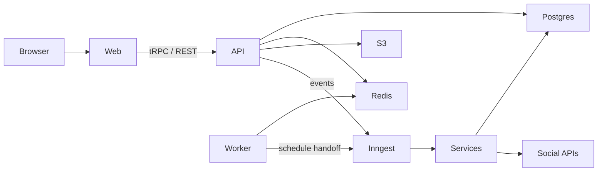

# Fannout

**Write once, publish everywhere.**

Fannout is a social publishing product: upload or organize media once in a library, compose a post, and fan it out to connected accounts (LinkedIn, X, YouTube, Facebook Pages, Instagram, Threads). Scheduling, AI-assisted copy, folders, analytics, and personal API keys are built in.

This repository is a **pnpm + Turborepo** monorepo. The product name is **Fannout** (spelled with two **n**’s).

---

## What runs where

| Piece | Role |
| --- | --- |
| **Web** (`apps/web`) | Next.js App Router UI — compose, media library, posts, connections, settings. Clerk for sign-in. |
| **API** (`apps/api`) | Express + tRPC HTTP API, OpenAPI/Scalar docs, Clerk webhooks, OAuth callbacks, Inngest serve endpoint. |
| **Worker** (`apps/worker`) | BullMQ consumer for **scheduled** posts (handoff to Inngest at the right time). |
| **Inngest** (via API) | Durable background work: media processing, publish/delete/edit on platforms, analytics sync, notifications. |

Persistent data: **PostgreSQL** (Drizzle), **Redis** (cache + BullMQ), **S3-compatible storage** (uploads and derivatives).



---

## Repository layout

### Applications

| Path | Package | Default port |
| --- | --- | --- |
| `apps/web` | `web` | `3000` (`WEB_PORT`) |
| `apps/api` | `@repo/api` | `8000` (`PORT`) |
| `apps/worker` | `@repo/worker` | (no HTTP) |

### Shared packages

| Path | Purpose |
| --- | --- |
| `packages/trpc` | tRPC router, procedures, OpenAPI metadata |
| `packages/services` | Business logic (media, publishing, scheduling, OAuth, API keys, …) |
| `packages/database` | Drizzle schema, migrations, `db:studio` |
| `packages/inngest` | Inngest client, event types, function definitions |
| `packages/providers` | Platform SDK wrappers (Meta, X, Google, LinkedIn, …) |
| `packages/s3` | Uploads, presigning, multipart |
| `packages/redis` / `packages/bullmq` | Cache and job queues |
| `packages/ai` | OpenAI-backed compose helpers |
| `packages/errors` | Typed error codes for API and UI |
| `packages/logger` | Shared logging |
| `packages/eslint-config` / `packages/typescript-config` | Tooling |

### Documentation (start here when changing behavior)

| Doc | Contents |
| --- | --- |
| [`docs/conventions/api.md`](docs/conventions/api.md) | Pagination, deletes, Inngest for platform calls, capabilities |
| [`docs/conventions/frontend.md`](docs/conventions/frontend.md) | Infinite lists, optimistic UI, confirm dialogs |
| [`apps/web/DESIGN.md`](apps/web/DESIGN.md) | UI tokens, components, accessibility |
| [`docs/ai.md`](docs/ai.md) | Generated HTTP API guide for agents (from OpenAPI) |
| [`docs/ai.template.md`](docs/ai.template.md) | Hand-written workflow sections merged into `ai.md` |
| [`CLAUDE.md`](CLAUDE.md) | Agent/contributor checklist for this repo |

Platform-specific notes live under [`docs/providers/`](docs/providers/).

---

## Prerequisites

- **Node.js** ≥ 18 (see root `package.json`)
- **pnpm** 9 (`packageManager` in root `package.json`)
- **Docker** (recommended) for Postgres, Redis, and MinIO locally
- **ffmpeg/ffprobe** on your PATH if you process video locally (see `FFPROBE_PATH` in `.env.example`)
- Accounts and apps with each social provider you want to test (OAuth env vars in `.env.example`)

---

## Local development

### 1. Clone and install

```sh
git clone <repo-url> fannout
cd fannout
pnpm install
```

### 2. Environment

```sh
cp .env.example .env
./setup.sh   # symlinks root .env into apps/* and packages/*
```

Fill in at minimum:

- **Database** — `DATABASE_URL` (defaults match docker-compose)
- **Clerk** — publishable/secret keys and webhook signing secret
- **URLs** — `WEB_URL`, `API_PUBLIC_URL`, `NEXT_PUBLIC_API_URL`, OAuth redirect URIs
- **S3** — MinIO defaults work with docker-compose
- **Security** — `TOKEN_ENCRYPTION_KEY`, `API_KEY_PEPPER` (`openssl rand -base64 32`)

Comments in [`.env.example`](.env.example) document every variable.

### 3. Infrastructure

```sh
docker compose up -d
```

Starts **Postgres** (5432), **Redis** (6379), **MinIO** (9000 API, 9001 console), and creates the `fannout-media` bucket.

### 4. Database migrations

```sh
pnpm db:migrate        # development (drizzle-kit)
# pnpm db:migrate:deploy   # production-style apply (CI/deploy)
```

Optional: `pnpm --filter @repo/database dev` runs **Drizzle Studio**.

### 5. Run the stack

**Terminal A — apps (web + API + worker via Turbo):**

```sh
pnpm dev
```

**Terminal B — Inngest dev server** (required for uploads finishing, publishing, deletes, etc.):

```sh
pnpm inngest:dev
```

By default the CLI targets the API’s Inngest route (`http://localhost:8000/api/inngest` — see `.env.example`).

### 6. Smoke-check URLs

| URL | What |
| --- | --- |
| http://localhost:3000 | Web app |
| http://localhost:8000/trpc | tRPC (used by the web client) |
| http://localhost:8000/docs | Scalar OpenAPI reference |
| http://localhost:3000/theme-preview | Design token preview (dev) |

---

## Clerk (users and webhooks)

1. Create a Clerk application and copy keys into `.env`.
2. In Clerk Dashboard → **Webhooks**, add:
   - Endpoint: `{API_PUBLIC_URL}/webhooks/clerk`
   - Events: `user.created`, `user.updated`, `user.deleted`
3. Put the signing secret in `CLERK_WEBHOOK_SIGNING_SECRET`.
4. For local webhooks, expose the API with a tunnel (ngrok, Cloudflare Tunnel, etc.) and set `API_PUBLIC_URL` to that HTTPS origin.

The API upserts application users from webhooks; the web app reads the signed-in user via `@clerk/nextjs`.

---

## OAuth and platforms

OAuth callbacks are served by the **API** on port **8000** (`/api/oauth/{provider}/callback`). Redirect URIs in `.env` must match provider dashboards exactly.

| Provider | Notes |
| --- | --- |
| LinkedIn | Optional `LINKEDIN_USE_COMMUNITY_API` for Community Management API |
| X | All listed scopes required for posting |
| YouTube | Google OAuth + YouTube Data API |
| Facebook / Instagram | Meta app; Instagram often uses **Login for Business** `INSTAGRAM_CONFIG_ID` |
| Threads | HTTPS redirect URI required (use a tunnel locally) |

Detailed setup: [`.env.example`](.env.example) and [`docs/providers/`](docs/providers/).

---

## Commands

| Command | Description |
| --- | --- |
| `pnpm dev` | Web, API, and worker in watch mode |
| `pnpm inngest:dev` | Local Inngest orchestrator |
| `pnpm build` | Production build (all apps that define `build`) |
| `pnpm start` | Run production builds (after `pnpm build`) |
| `pnpm lint` | ESLint across packages; web includes design lint; API agent doc check in the lint graph |
| `pnpm check-types` | TypeScript `tsc` / Next typegen |
| `pnpm test` | Unit tests (services, API, web token/lint tests, trpc pagination, …) |
| `pnpm format` | Prettier on `ts`, `tsx`, `md` |
| `pnpm db:generate` | Generate Drizzle migrations from schema changes |
| `pnpm db:migrate` | Apply migrations (dev) |
| `pnpm db:migrate:deploy` | Apply migrations (deploy/CI) |
| `pnpm db:reset` | Reset database (destructive; dev only) |
| `pnpm docs:agent` | Regenerate [`docs/ai.md`](docs/ai.md) from OpenAPI |
| `pnpm docs:agent:check` | Fail if `docs/ai.md` is stale (runs in lint pipeline) |

Ad-hoc maintenance scripts (require `.env`): `pnpm youtube:stuck`, `pnpm x:debug`, `pnpm mentions:backfill-instagram` — see root `package.json`.

---

## API surface

- **Browser**: `@trpc/react-query` → `NEXT_PUBLIC_API_URL` (or same-origin `/trpc` if proxied).
- **Humans / agents with API keys**: REST shapes from tRPC OpenAPI at `{API_PUBLIC_URL}/api/...`.
- **Contract for LLM agents**: [`docs/ai.md`](docs/ai.md) (regenerate after changing scoped endpoints).

When you add or change API-key-accessible endpoints, update Zod `.describe()` on fields, run `pnpm docs:agent`, and commit `docs/ai.md` in the same change.

---

## Background processing model

- **Inngest** — media transcode/thumbnail, `media/delete.requested`, `post/publish.requested`, platform delete/edit, analytics crons, notification fan-out, AI naming, etc. Functions are registered in `packages/inngest/functions.ts` and served from the API.
- **BullMQ worker** — scheduled publish **handoff** only (versioned job ids; worker re-validates DB state before enqueueing Inngest).

Platform mutations and deletes should not run inline in HTTP handlers; they enqueue Inngest events (see conventions doc).

---

## UI development

- Follow [`apps/web/DESIGN.md`](apps/web/DESIGN.md) — semantic colors, one primary action per screen, `radius-control` / `radius-surface`.
- Lists use `useInfiniteList` + `<InfiniteList>`; destructive actions use `ConfirmDialog`.
- Brand tokens: `apps/web/app/globals.css` and `apps/web/lib/brand.ts`.

---

## Testing and quality

```sh
pnpm test
pnpm lint
pnpm check-types
```

Pagination rules for list procedures are enforced in `packages/trpc/test/pagination.test.ts`. PRs should use [`.github/pull_request_template.md`](.github/pull_request_template.md).

---

## Deployment

Production deploy is described in [`.github/workflows/deploy.yml`](.github/workflows/deploy.yml): SSH to a host (via Cloudflare Access), `git fetch` + `pnpm install`, `pnpm db:migrate:deploy`, `pnpm build`, `systemctl restart fannout`.

On the server:

- Node 18+, pnpm 9, root `.env` (not committed)
- Postgres, Redis, S3, Inngest Cloud (or `INNGEST_DEV=1` + dev server in homelab), reachable OAuth redirect URLs
- Systemd unit running `pnpm start` from the deploy directory

`NODE_ENV` must be `development` or `prod` (the string `production` is **not** accepted — see `.env.example`).

---

## Knowledge graph (optional)

The repo may include `graphify-out/` (AST-derived code graph). After substantive code changes, contributors often run `graphify update .` to refresh it. Large `graph.json` diffs on PRs are expected.

---

## License and naming

Private monorepo. When referring to the product in docs and UI, use **Fannout** (two **n**’s).